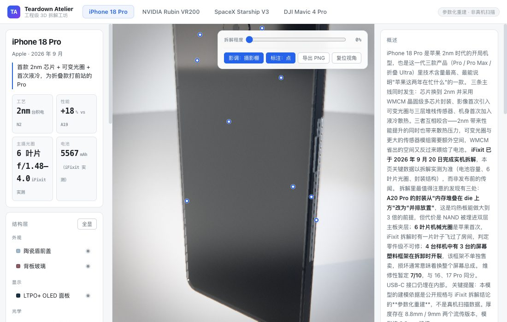
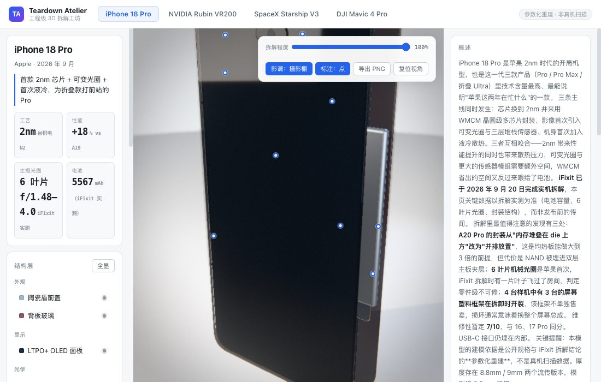
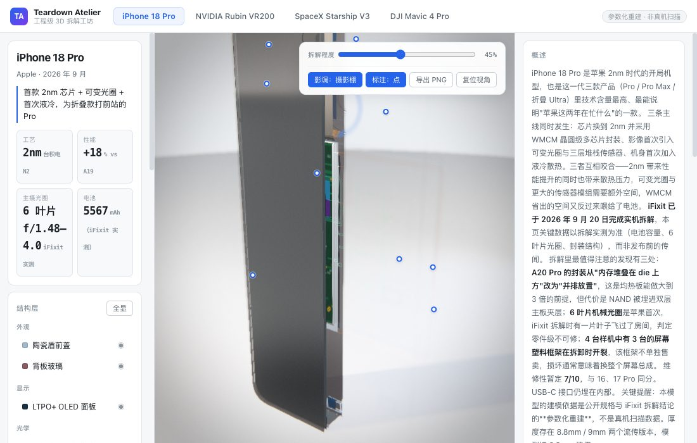

# teardown-atelier

> **拆解工坊** — 一个用 three.js 手搓的交互式 3D 拆解台。把旗舰硬件按结构层拆开、推拉爆炸、剖切看截面，并且用影棚级渲染把它拍成"产品图"而不是"线框图"。
>
> An interactive 3D teardown workbench built with three.js — exploded views, live sectioning, and studio-grade rendering that aims for product-photography realism rather than wireframe aesthetics.



## 四个主体

| 主体 | 层数 | 网格 | 三角面 | 关键结构 |
|---|---|---|---|---|
| **iPhone 18 Pro** | 9 | 139 | 32.4k | 6 叶片机械光圈、WMCM 侧边封装、均热板、5567mAh 电池 |
| **NVIDIA Rubin VR200** | 6 | 319 | 6.2k | 四 compute tile、8 组 HBM4、CoWoS 中介层 |
| **SpaceX Starship V3** | 6 | 652 | 57.3k | Super Heavy 33 台 + Ship 6 台猛禽、隧道管、内藏式栅格舵 |
| **DJI Mavic 4 Pro** | 7 | 245 | 11.0k | 云台三摄、电机、O4 图传、遥控器 |

每个主体带热点标注：点一下展开该层的工程说明与关键参数。



## 功能

- **拆解滑块** — 0–100% 连续爆炸，每层有独立的方向与距离
- **剖切** — X / Y / Z 三轴实时裁剪，看内部堆叠
- **层控制** — 单独显隐、隔离单层、悬停高亮
- **影调开关** — 摄影棚 / 素图两档（见下）
- **导出 PNG** — 2× 超采样渲染后下载
- **URL 深链接** — `?subject=starship&explode=60&section=x&photo=0`



## 渲染：为什么它看起来像照片

这一部分是项目的重点。默认的 three.js 渲染（一个平行光 + 一个环境贴图）出来的是"3D 默认渲染"味，本项目按影棚逻辑重搭了整条链路：

**环境光照（IBL）** — 不用 `RoomEnvironment`，而是搭一个"黑房 + 6 块柔光箱"的小场景，用 `PMREMGenerator` 烘焙成环境贴图。产品摄影的质感来自大面积柔光箱在金属与玻璃上投出的**矩形柔和高光条**；柔光箱光斑是解析生成的超椭圆衰减贴图，`MeshBasicMaterial.color` 用 `setRGB(gain, …)` 给到 1 以上（PMREM 期间 three 会强制关闭色调映射，半浮点目标留得住 >1 的亮度）。

**其中有一块是"正面反光板"** — 竖立物体的正面玻璃只会反射**水平线以下**的景物（入射角等于反射角，相机在上方时反射光必然指向下）。所有灯都放在上方的话，手机正面就是一团纯黑。影棚给手机拍正面的标准做法是在玻璃下方放一块白板，位置要卡在正面法线的镜像方向上。加上它之后 iPhone 正面平均亮度从 27 提升到 88。

**灯光** — 3 个 `RectAreaLight` 与 IBL 柔光箱同坐标摆放，保证"看到的反射"和"投出的阴影"是同一盏灯；平行光只负责投影，阴影相机按主体包围盒自适应拟合。

**后期链** — `Render → Bokeh 景深 → UnrealBloom → Output(Neutral 色调映射) → 自写 PhotoGrade(暗角/颗粒/色差/S曲线) → SMAA`。景深焦点每帧锁在轨道中心。PhotoGrade 放在 OutputPass **之后**——颗粒和暗角本来就该在 sRGB 显示域加，跟相机成像链路一致。

**材质** — 拉丝金属用 `MeshPhysicalMaterial.anisotropy`（各项同性高光会把金属抹成塑料感）；手机前后盖是深色高 clearcoat 面板而不是 `transmission 0.92` 的透射玻璃——真实手机前后不透光，靠反射成像。

**「影调：素图」不只是关滤镜** — `BokehPass` 会用 `MeshDepthMaterial` 把整个场景再渲染一遍取深度，关掉它省掉的是双倍绘制调用。星舰 652 个网格时这一遍很贵。

## 性能

静态观察时不做无用功：

- `shadowMap.autoUpdate = false`，几何真正变化时才 `needsUpdate`（相机转动不改变阴影，省掉一次全场景渲染）
- 射线拾取从 `pointermove` 挪到帧循环——高精度鼠标的 pointermove 频率远高于刷新率
- 标注锚点按"相机矩阵 + 爆炸量 + 可见性版本"做缓存键，静止时跳过 DOM 写入
- 材质克隆按 (层, 材质) 共享，切换主体时显式 `dispose` 几何体与材质

## 运行

```bash
npm install
npm run dev        # 开发服务器
npm run build      # 产物在 dist/
npm run preview    # 预览构建产物
```

## 数据准确性

建模依据是**公开发布的技术规格与权威拆解结论**，不是工程图纸：

- iPhone 18 Pro 的关键数据来自 **iFixit 2026-09-20 实机拆解**（电池 Pro 4288mAh / Pro Max 5567mAh、6 叶片光圈 f/1.48–4.0、A20 Pro 改为 die 与内存并排封装）
- Starship V3 的尺寸与推力来自 **SpaceX 官网技术规格**（起飞推力 8240 吨力、Super Heavy 72m + Ship 52m）
- 规格页面里标注了每个主体的"建模颗粒度"：真实零件数 vs 模型表达的层数

模型是参数化重建，比例按公开尺寸，但发动机内部流道、隔热瓦实际排布等为结构性示意。

## 结构

```
src/
  core/
    studio.ts        # 影棚 IBL + 球形渐变背景罩 + 地台
    viewer.ts        # 场景、灯光、后期链、交互、拾取
    materials.ts     # 统一材质库（各向异性金属、深色面板、透射玻璃…）
    textures.ts      # 程序化 Canvas 贴图（PCB/拉丝/碳纤维/晶圆/柔光箱/背景罩）
    types.ts
  subjects/
    iphone18.ts  rubin.ts  starship.ts  mavic4.ts
  main.ts  style.css
```

## 已知限制

- `BokehPass` 的深度材质已同步剖切面，但剖切出的截面没有"盖面"——看到的是壳体内部而非实体截面
- 隔热瓦以阵列示意（星舰 26 列 × 7 行 = 182 片），未按真实 18000 片生成
- 单台发动机内部零件未展开（Raptor 单台 200+ 零件）

## License

MIT
